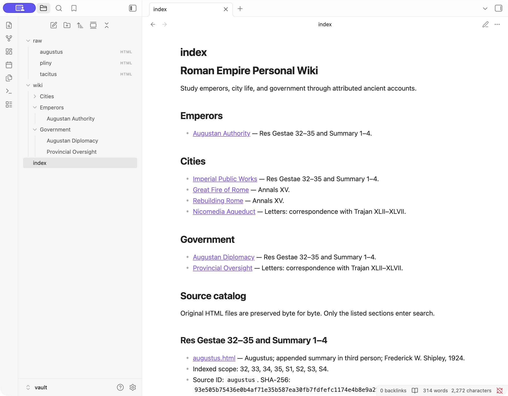
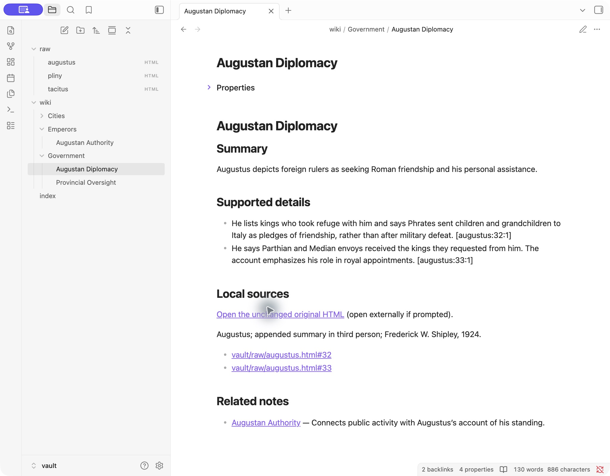
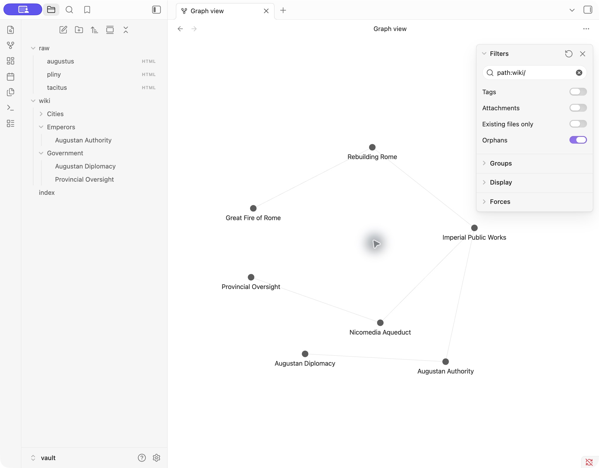

# Roman Empire Personal Wiki

An original Python CLI for studying emperors, city life, and government through Augustus, Tacitus, and Pliny’s correspondence with Trajan. Clio is a playful conversational study buddy; `ask` is independent factual research. RAG provides source context at inference time; it does not train Gemma.

Start with the [human wiki](vault/index.md), [fixed expectations](evaluation/expectations.json), and [failure/change log](evaluation/changes.md). The supplied assignment Word document is the rubric and is excluded from publication.

## Run locally

From this folder:

```bash
python3 -m venv .venv
.venv/bin/python -m pip install -r requirements.txt
.venv/bin/python scripts/download_sources.py
# In terminal 1; leave this running:
scripts/start_ollama.sh
# In terminal 2, while connected, if the weights are missing:
OLLAMA_HOST=127.0.0.1:11435 ollama pull gemma4:e2b-it-qat
./wiki help
./wiki ingest vault/raw/augustus.html
./wiki ingest vault/raw/tacitus.html
./wiki chat
./wiki search 'Nero homeless'
./wiki ask 'How did Nero help people left homeless by Rome’s fire?' --mode local
```

For a fresh clone, download dependencies before the offline demonstration:

```bash
mkdir -p vendor
.venv/bin/python -m pip download --dest vendor -r requirements.txt
.venv/bin/python -m pip install --no-index --find-links vendor -r requirements.txt
.venv/bin/python scripts/download_sources.py
```

Install Ollama from its official site if absent. The recorded setup uses Python 3.13 and Ollama 0.34.3. `wiki` resolves its own project directory, so paths to the launcher may contain spaces. Wheels in the local `vendor/` folder cover this Mac’s Python/architecture; download compatible wheels before disconnecting on another machine. Weights and wheels remain local and are excluded from Git.

`chat` supports `/notes QUESTION` and `/quit`. Explicit requests using “in/from/using/search/check the wiki/notes” also invoke retrieval. Ordinary capability questions and drafts skip retrieval. “Make that shorter” sees recent turns. History is limited to six messages and 5,000 characters, with a 3,000-character turn limit. Conversation is saved in run records but is not loaded by `ask` or indexed. A fresh chat starts with no history.

`ingest` generates drafts in `data/staging/`, never silently replaces reviewed pages. Compare a draft’s claims with its source and its saved model run, edit the draft if needed, then run `./wiki review NOTE-KEY --approve`. `./wiki ingest PATH --redraft` stages proposed revisions; existing notes remain unchanged. Explicit approval backs up replaced notes. Unknown source checksums require an explicitly reviewed source profile rather than broad ingestion of arbitrary folders.

For a later rename, use `./wiki rename NOTE-KEY 'New Title'`, then rerun the evaluation and vault checks. This updates filenames, headings, incoming links, persistent mappings and note specifications, and rebuilds the evidence index. Retrieval paths always point to unchanged originals, so note renames cannot redirect citations to generated text.

## Device and model

The supplied device specification is a MacBook Air M5, macOS 26.6.2, 10 CPU cores, 8 GPU cores, and 16 GiB unified memory. The baseline capture records actual hardware, disk, available memory, swap, model metadata and runtime: [baseline.json](results/baseline.json). Hardware serial numbers and UUIDs were removed.

Selected model: **gemma4:e2b-it-qat**, Q4_0 main weights, full manifest digest `07ea59a474013479c8b6b802bef095c40e964a1d776ba02f264c0e30e1aede0c`, downloaded size 4,336,358,185 bytes. The multimodal projector uses a different precision; Q4_0 does not describe every tensor. Text-only requests use a 4,096-token context, output cap 850, temperature 0.1, seed 42, thinking disabled, one request at a time, one loaded model, and a ten-minute keep-alive.

E2B/E4B describe roughly 2B/4B effective parameters; embedding tables also occupy memory. A 26B A4B MoE has roughly 26B total parameters with about 4B active per token; active count is not its loading footprint. Google’s approximate Q4_0 loading estimates are 2.9/4.5/14.4 GB before additional costs. E2B is the most conservative of these options for this 16 GiB machine, particularly under existing memory pressure. Only the selected model was downloaded/tested. See [official model](https://ollama.com/library/gemma4:e2b-it-qat) and [Google model guidance](https://ai.google.dev/gemma/docs/core).

Before loading, psutil measured about 2.99 GiB available memory and 4.85 GiB swap used; free disk was approximately 189 GiB before the download. Other applications remained open, so results reflect a busy system. Do not confuse low “free” pages with “available” memory. No dedicated VRAM is added to unified RAM. Process RSS and Ollama model/GPU allocation are reported as separate views, **not summed** as independent physical memory.

## Architecture and code walkthrough

- **Model/runtime:** [runtime.py](romanwiki/runtime.py) talks only to `127.0.0.1:11435`, disables proxy use, checks that the exact weights exist, serializes calls with a file lock, and samples memory every half second. [start_ollama.sh](scripts/start_ollama.sh) sets `OLLAMA_NO_CLOUD=1`, loopback binding and single-request configuration. See [Ollama local-only guidance](https://docs.ollama.com/faq). Normal commands never pull weights, browse, or fall back to a hosted service.
- **Retrieval tool:** [sources.py](romanwiki/sources.py) extracts explicitly selected sections with Beautiful Soup. [store.py](romanwiki/store.py) uses SQLite FTS5 with Porter tokenization and BM25 over original text. Up to four passages are returned. A small general vocabulary expansion bridges terms such as “help/relieve” and “fire/conflagration.” Original source wording is retained after whitespace normalization, removal of markup/footnote markers and soft hyphens. Raw HTML is byte-preserved.
- **RAG workflow:** [harness.py](romanwiki/harness.py) retrieves evidence, loads [research rules](instructions/research.md), sends a standalone request, validates JSON plus citation ID/path/exact quotation, displays the result, and saves inputs/outputs. Empty retrieval gives an explicit no-evidence result without generation. Invalid JSON/citations and server/weights failures are errors, not evidence refusals.
- **Harness/CLI:** [__main__.py](romanwiki/__main__.py) selects modes with argparse. `Chat` loads a separate [persona](instructions/persona.md), retains bounded recent history, and uses retrieval only for explicit source requests. [ingest.py](romanwiki/ingest.py) preserves originals, indexes extracted sections independently of draft success, generates local Gemma drafts, and manages review/mappings. [evaluate.py](scripts/evaluate.py) owns the answer key; the application never imports it.

Trace one question: `wiki ask` → `harness.ask` → `store.search` → four source passages → research prompt → `runtime.generate` → local Ollama → `harness.validate` → rendered answer plus `results/runs/*.json`. Each successful model run retains messages, exact response, identity, settings, durations, memory samples, and `/api/ps`. Citation validation proves that a quoted string came from the supplied passage; it does **not** establish that every claim follows. Separate evidence-card assessments perform that review.

Passages aim at 150–250 words and preserve section boundaries; short letters/sections remain short, and long sections split at sentence boundaries. No generated note, chat, draft, expected answer, or prior response enters FTS. `data/evidence.sqlite` is rebuildable and excluded from Git. Persistent `data/mappings.json` preserves reviewed filenames and source-to-note relationships.

## Sources and the human vault

Unchanged originals live in `vault/raw/`; checksums, edition attribution, URLs, rights notices and indexed scopes are in [config/sources.json](config/sources.json). Full downloads are preserved beyond the indexed sections:

| Original | Indexed evidence | Source location |
|---|---|---|
| Augustus, Shipley | Res Gestae 32–35; appended Summary 1–4 | English table cells, native chapter anchors |
| Tacitus, Church–Brodribb | Annals XV.38–44 | Verified chapter boundaries mapped to MIT line anchors 650–795 |
| Pliny/Trajan, Melmoth | Trajan correspondence XLII–XLVII | Heading plus native HTML anchor; avoids repeated numerals in other letters |

Seven notes are grouped under Emperors, Cities and Government. Titles are filenames and first headings; source IDs/checksums stay in metadata. [Note specifications](config/notes.json) define coherent topics and related links. [Editorial review script](scripts/review_notes.py) records source-checked revisions to actual Gemma drafts; the raw model output is preserved. The grouped [index](vault/index.md) includes a source catalog and local links. Open **vault/** itself in Obsidian, not this repository.

Distribution: Augustus and Pliny originals are included with their notices. **The MIT Tacitus HTML is excluded from GitHub** and downloaded directly during setup, with its original checksum verified. Local source links require that setup step. This resolves publication without changing the evaluated source or claiming permission to redistribute its presentation. See [third-party notices](THIRD_PARTY_NOTICES.md).

## Tests and offline demonstration

The four questions and expected sections were frozen before retrieval implementation: [expectations](evaluation/expectations.json), [freeze checksum](evaluation/freeze.json), [expected passages](evaluation/expected-passages.json). These files are outside the corpus. Earlier failed outputs are retained; [changes](evaluation/changes.md) explains corrections and reruns.

```bash
.venv/bin/python -m unittest discover -s tests -v
.venv/bin/python scripts/evaluate.py --label connected
.venv/bin/python scripts/check_vault.py
.venv/bin/python scripts/check_reingestion.py
```

To reproduce the required first offline ingestion on a fresh setup, ingest only Augustus and Tacitus while connected. Download Pliny but leave it unindexed. Disconnect Wi-Fi and all other internet connections, then run:

```bash
scripts/offline_demo.sh
```

The standalone runner records interface/default-route checks before and after, refuses to ingest Pliny unless offline, restarts the assignment-specific runtime, launches new CLI processes, measures cold/warm asks, ingests Pliny, runs all four questions and chat/search checks, runs unit tests, stops Ollama, and verifies search still works while ask reports a runtime error. It does not depend on this conversation. An optional `scripts/offline_with_wifi_restore.sh` wrapper disables Wi-Fi and restores its original on/off state on exit; other connections are untouched and must be disconnected separately.

The final run completed with **101 continuous offline samples**, successful ingestion/redrafting, all four evaluation cases, chat checks and unit tests. Search worked after Ollama stopped; factual generation returned the expected runtime error. [Recorded transcript](results/offline-20260929T215623/terminal.txt), [network and exit-code proof](results/offline-20260929T215623/runner-summary.json), and [evaluation summary](results/offline-20260929T215714/summary.json) preserve the actual results. Earlier attempts reconnected and are explicitly not offline proof. The final run re-ingested Pliny; its first ingestion occurred during an earlier interrupted-offline attempt.

Read the evidence and independent claim reviews: [Augustus](results/evidence-cards/augustus.md), [Nero](results/evidence-cards/nero.md), [Pliny/Trajan](results/evidence-cards/pliny.md), and [unsupported death toll](results/evidence-cards/unsupported.md). Original machine records retain their initial pending-review label; the separate evidence cards contain the completed assessment.

Cold/warm Augustus calls took **17.04 / 11.66 seconds**. The three final supported answers took 10.51–13.14 seconds; refusal took 2.57 seconds. [Measured memory and timing](results/measurements.md) distinguishes Python RSS, summed Ollama-process RSS, available RAM, swap and runtime allocation. Measurement permission failures are recorded as unavailable, never zero.

[Mode review](results/mode-review.md), [Obsidian verification](results/obsidian-review.md), [rubric checklist](evaluation/rubric-checklist.md), and [unchanged re-ingestion proof](results/reingestion-summary.txt) cover the remaining checks.





## Reflection

An observed failure was an exact-looking quotation made by joining separated source sentences. The validator rejected it, but the initial ingestion ordering also prevented valid Tacitus passages from being indexed; the next Nero answer used an irrelevant Augustus passage. The corrected implementation indexes validated originals independently of draft generation. Another answer omitted rank despite quoting the complete Augustus passage. These are concrete examples of why a correct citation format is not enough.

A useful next improvement is a claim-by-claim entailment and completeness review step with a separate approval record before presenting an answer as reviewed. This small model also needs tighter output budgeting and tested handling of source follow-ups in `/notes`; ordinary conversational follow-ups already retain context. Keyword retrieval can miss paraphrases. A local embedding reranker could be evaluated against a larger frozen question set without introducing a cloud dependency.

## Publish and submit yourself

1. Review [third-party notices](THIRD_PARTY_NOTICES.md). The restricted MIT HTML is excluded and obtained directly during setup. Inspect all shareable files and remove private material. The supplied `.docx`, model weights, dependencies, credentials and Obsidian workspace state are ignored. Do not use `git add .` until the publication check is complete.
2. Create your own empty **public** GitHub repository. In this folder, check `git status --short`; add the reviewed code, README, config, instructions, evaluation, mappings, shareable originals/notes and results. Commit, set the remote and push:

   ```bash
   git add README.md .gitignore requirements.txt wiki romanwiki scripts tests config instructions evaluation data/mappings.json vault results
   git commit -m "Build local Roman Empire wiki CLI and record evaluation"
   git branch -M main
   git remote add origin https://github.com/YOUR-USERNAME/YOUR-REPOSITORY.git
   git push -u origin main
   ```

3. Open the public repository while signed out. Check README links, all seven notes, originals, four evidence cards, offline transcript and screenshots. Follow setup/launch instructions from a fresh environment with all downloads completed before disconnection.
4. Submit that one repository URL through the course portal. Publishing and submission status is recorded in the handoff; no course submission is claimed without a portal receipt.
